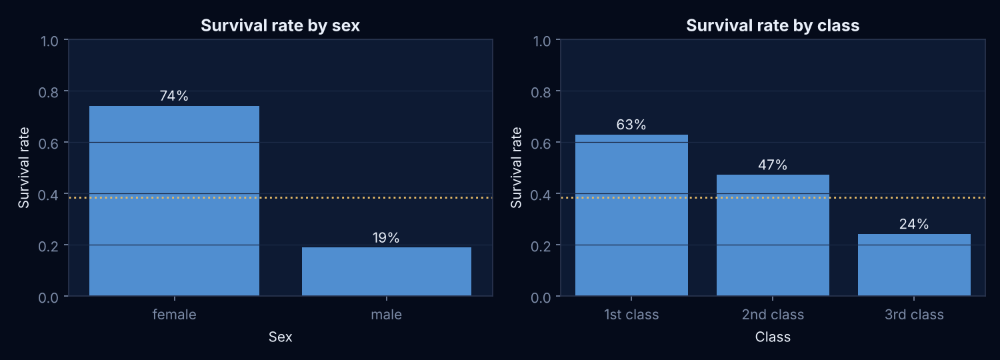
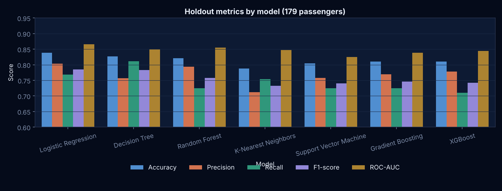
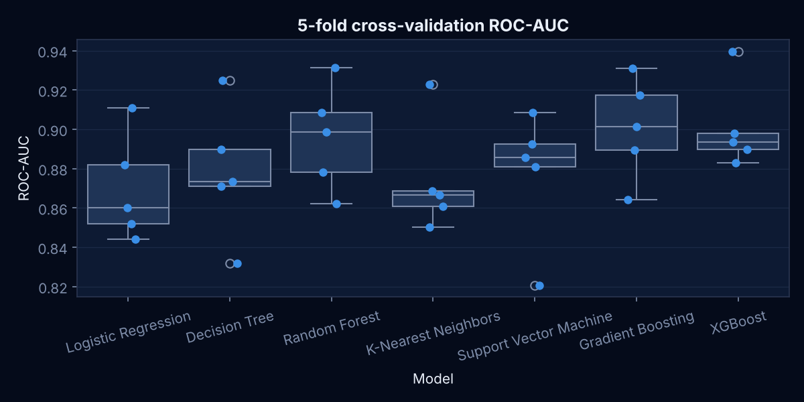
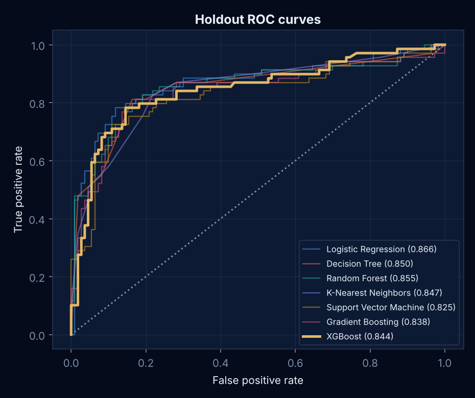
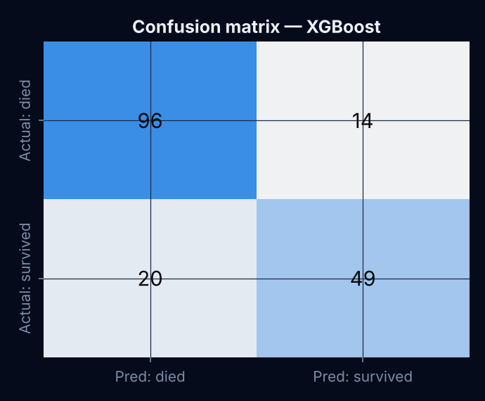
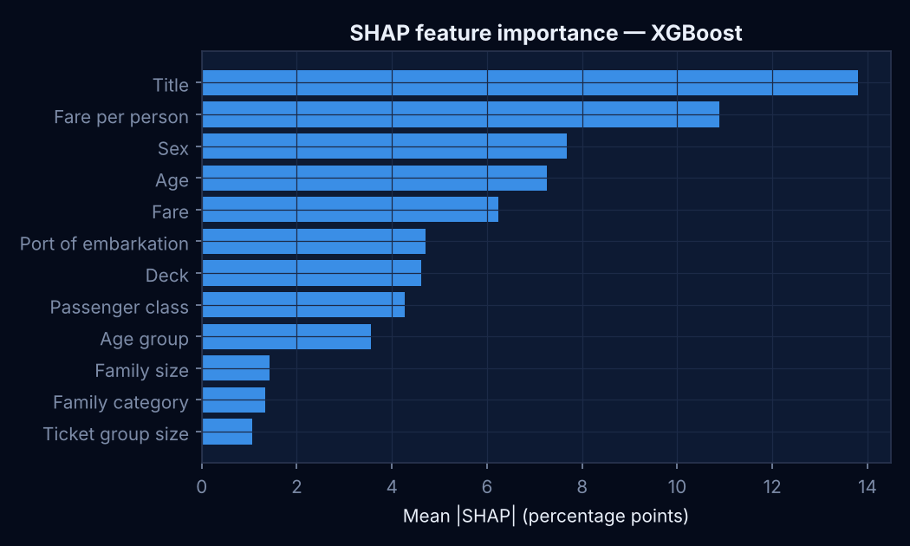

# Titanic ML Lab — Project Report

*Generated 2026-11-12 19:11 UTC by `scripts/generate_report.py` from the models trained in this repository. No number in this report was typed by hand.*

Environment: Python 3.13.18 · scikit-learn 1.9.1 · pandas 3.0.5 · NumPy 2.5.3 · XGBoost 3.4.1

## 1. Data

- `train.csv`: 891 passengers × 12 columns — official Kaggle file (SHA-256 verified: yes).
- `test.csv`: 418 passengers, no labels (SHA-256 verified: yes).
- Survivors: 342 (38.4%); non-survivors: 549. Duplicates: 0.

| column | missing | missing_pct | strategy |
|---|---|---|---|
| Cabin | 687 | 77.1 | Not imputed — converted to 'CabinKnown' and 'Deck' (Unknown kept as a category) |
| Age | 177 | 19.9 | Median per title group (learned on training folds) + 'AgeKnown' indicator |
| Embarked | 2 | 0.2 | Most frequent port (learned on training folds) |

### Automatically generated insights

- **Overall survival** — 342 of 891 passengers in this dataset survived (38.4%).
- **Sex was strongly associated with survival** — Female passengers survived at 74.2% vs 18.9% for males (3.9× higher; χ² p = 1.2e-58).
- **Survival differed between passenger classes** — 1st class 63.0%, 2nd class 47.3%, 3rd class 24.2% (χ² p = 4.5e-23).
- **Age contains predictive information** — Children under 13 survived at 58.0% vs 38.1% for adults (age known for 80% of passengers).
- **Family composition mattered** — Small families (2–4) survived at 57.9%, people travelling alone at 30.4%, and large families (5+) at only 16.1%.
- **Missing data can itself be informative** — Passengers with a recorded cabin survived at 66.7% vs 30.0% without — cabin records were far more complete for 1st-class passengers.
- **Embarkation port differed** — Highest survival among passengers boarding at Cherbourg (55.4%), lowest at Southampton (33.7%). This mostly reflects the class mix at each port — a reminder that correlation is not causation.
- **Survival rose with fare** — Survival rose from 19.7% in the cheapest fare quartile to 58.1% in the most expensive (fare is closely tied to passenger class).

Correlation is not causation: these are associations in historical data.

## 2. Method

- Stratified 80/20 split (seed 42): **712** development passengers, **179** holdout passengers.
- All preprocessing (feature engineering, imputation, one-hot encoding, scaling) inside one scikit-learn `Pipeline`, refit inside every CV fold.
- 5-fold `StratifiedKFold` on the development set; `RandomizedSearchCV` with 30 candidates per model, optimising ROC-AUC.
- Model selection: highest mean CV ROC-AUC (tie-break CV F1, then lower std). The holdout is only used for the final, reported metrics.
- Final models are refit on all 891 labelled passengers for predictions and the Kaggle submission.

## 3. Preprocessing & feature experiments

All with default hyper-parameters, 5-fold CV ROC-AUC on the development set.

### 3.1 Scaling

| model | none | robust | standard |
|---|---|---|---|
| K-Nearest Neighbors | 0.777 | 0.850 | 0.851 |
| Logistic Regression | 0.869 | 0.869 | 0.870 |
| Support Vector Machine | 0.765 | 0.867 | 0.873 |

Chosen: Logistic Regression → standard, K-Nearest Neighbors → standard, Support Vector Machine → standard

### 3.2 Base (7) vs engineered (17) features

| model | base | engineered | gain |
|---|---|---|---|
| Decision Tree | 0.7535 | 0.7745 | 0.0210 |
| Gradient Boosting | 0.8829 | 0.8977 | 0.0148 |
| K-Nearest Neighbors | 0.8459 | 0.8509 | 0.0050 |
| Logistic Regression | 0.8546 | 0.8696 | 0.0149 |
| Random Forest | 0.8665 | 0.8765 | 0.0101 |
| Support Vector Machine | 0.8562 | 0.8727 | 0.0165 |
| XGBoost | 0.8765 | 0.8883 | 0.0117 |

### 3.3 Drop-one-feature ablation (Δ CV ROC-AUC when the feature is removed; negative = the feature helped)

| dropped | Logistic Regression | Random Forest | mean |
|---|---|---|---|
| TitleGroup | -0.0051 | -0.0032 | -0.0042 |
| FarePerPerson | +0.0008 | -0.0059 | -0.0026 |
| AgeGroup | +0.0006 | -0.0026 | -0.0010 |
| CabinKnown | -0.0004 | -0.0003 | -0.0003 |
| FamilySize | +0.0000 | +0.0006 | +0.0003 |
| AgeKnown | +0.0002 | +0.0024 | +0.0013 |
| IsAlone | -0.0002 | +0.0030 | +0.0014 |
| TicketGroupSize | +0.0033 | +0.0001 | +0.0017 |
| FamilyCategory | -0.0018 | +0.0054 | +0.0018 |
| Deck | +0.0018 | +0.0041 | +0.0029 |

Interpretation: removing **Title** costs the most (-0.0042 mean Δ ROC-AUC). Every individual change is smaller than the fold-to-fold standard deviation (≈0.02), largely because the engineered features overlap (FamilySize / IsAlone / FamilyCategory); for 6 of 10 features, removal slightly *improved* mean CV ROC-AUC. As a set, the engineered features beat the base features for 7 of 7 algorithms (3.2), so the engineered set was kept.

### 3.4 Pclass encoding × age imputation

| model | pclass_encoding | age_strategy | roc_auc | accuracy |
|---|---|---|---|---|
| Logistic Regression | onehot | title_group | 0.8696 | 0.8202 |
| Logistic Regression | onehot | median | 0.8673 | 0.8174 |
| Logistic Regression | ordinal | title_group | 0.8699 | 0.8216 |
| Logistic Regression | ordinal | median | 0.8672 | 0.8174 |
| Random Forest | onehot | title_group | 0.8765 | 0.8174 |
| Random Forest | onehot | median | 0.8780 | 0.8161 |
| Random Forest | ordinal | title_group | 0.8801 | 0.8174 |
| Random Forest | ordinal | median | 0.8799 | 0.8132 |

## 4. Model results

| Model | CV ROC-AUC | CV accuracy | CV F1 | Holdout Accuracy | Holdout Precision | Holdout Recall | Holdout F1-score | Holdout ROC-AUC | Fit time (s) | Features | Scaler |
|---|---|---|---|---|---|---|---|---|---|---|---|
| XGBoost ★ | 0.901 ± 0.020 | 0.836 | 0.781 | 0.810 | 0.778 | 0.710 | 0.742 | 0.844 | 0.066 | engineered | none |
| Gradient Boosting | 0.901 ± 0.023 | 0.831 | 0.775 | 0.810 | 0.769 | 0.725 | 0.746 | 0.838 | 0.423 | engineered | none |
| Random Forest | 0.896 ± 0.024 | 0.833 | 0.774 | 0.821 | 0.794 | 0.725 | 0.758 | 0.855 | 0.765 | engineered | none |
| Decision Tree | 0.878 ± 0.030 | 0.825 | 0.777 | 0.827 | 0.757 | 0.812 | 0.783 | 0.850 | 0.037 | engineered | none |
| Support Vector Machine | 0.878 ± 0.030 | 0.813 | 0.745 | 0.804 | 0.758 | 0.725 | 0.741 | 0.825 | 0.094 | engineered | standard |
| K-Nearest Neighbors | 0.874 ± 0.025 | 0.815 | 0.726 | 0.788 | 0.712 | 0.754 | 0.732 | 0.847 | 0.035 | engineered | standard |
| Logistic Regression | 0.870 ± 0.024 | 0.822 | 0.765 | 0.838 | 0.803 | 0.768 | 0.785 | 0.866 | 0.030 | engineered | standard |

### Tuned hyper-parameters

- **Logistic Regression**: `C=0.5414`, `l1_ratio=1`, `solver=liblinear`
- **Decision Tree**: `criterion=entropy`, `max_depth=3`, `min_samples_leaf=8`, `min_samples_split=5`
- **Random Forest**: `max_depth=None`, `max_features=0.5`, `min_samples_leaf=3`, `min_samples_split=2`, `n_estimators=528`
- **K-Nearest Neighbors**: `n_neighbors=10`, `p=1`, `weights=uniform`
- **Support Vector Machine**: `C=5.457`, `gamma=0.05`, `kernel=poly`
- **Gradient Boosting**: `learning_rate=0.04617`, `max_depth=3`, `min_samples_leaf=14`, `n_estimators=349`, `subsample=0.8909`
- **XGBoost**: `colsample_bytree=0.9934`, `learning_rate=0.1383`, `max_depth=5`, `min_child_weight=7`, `n_estimators=238`, `reg_lambda=0.2499`, `subsample=0.8845`

## 5. Selected model: XGBoost

Selected by mean CV ROC-AUC (0.901 ± 0.020). On the untouched holdout: accuracy 0.810, precision 0.778, recall 0.710, F1 0.742, ROC-AUC 0.844.

Note: Logistic Regression has the highest *holdout accuracy* (0.838). We deliberately do not select on the holdout (that would turn it into another tuning set) nor on accuracy alone; with 179 passengers, holdout differences of 2–3 points are within sampling noise (≈ ±3 pts standard error).

| class | precision | recall | f1-score | support |
|---|---|---|---|---|
| Did not survive | 0.828 | 0.873 | 0.850 | 110.000 |
| Survived | 0.778 | 0.710 | 0.742 | 69.000 |
| accuracy | 0.810 | 0.810 | 0.810 | 0.810 |
| macro avg | 0.803 | 0.791 | 0.796 | 179.000 |
| weighted avg | 0.808 | 0.810 | 0.808 | 179.000 |

Top features by mean |SHAP| (percentage points of survival probability): Title (13.8), Fare per person (10.9), Sex (7.7), Age (7.3), Fare (6.2), Port of embarkation (4.7).

Permutation importance (holdout ROC-AUC drop): Name (→ title) (0.132), Fare (0.058), Sex (0.041), Age (0.040), Passenger class (0.019), Cabin (→ deck, cabin recorded) (0.016).

## 6. Kaggle submission

`outputs/submission.csv` — 418 rows, columns `PassengerId,Survived`, model XGBoost; predicted survival rate 38.3% (training data: 38.4%). All format checks passed.

**The Kaggle leaderboard score is not known locally** — test labels are private. Submit the file at https://www.kaggle.com/competitions/titanic/submit to obtain it. Expect it to differ from the validation estimates above.

## 7. Limitations

- Small data: holdout metrics on 179 passengers have a standard error of roughly ±3 percentage points.
- CV scores of tuned models are mildly optimistic (the same folds chose the hyper-parameters); nested CV would remove this bias.
- Models capture historical associations (sex, class, age, family) — not causes — and must not be used to judge individuals.
- Cabin is missing for 77% and age for 20% of passengers; crew are absent from the dataset.
