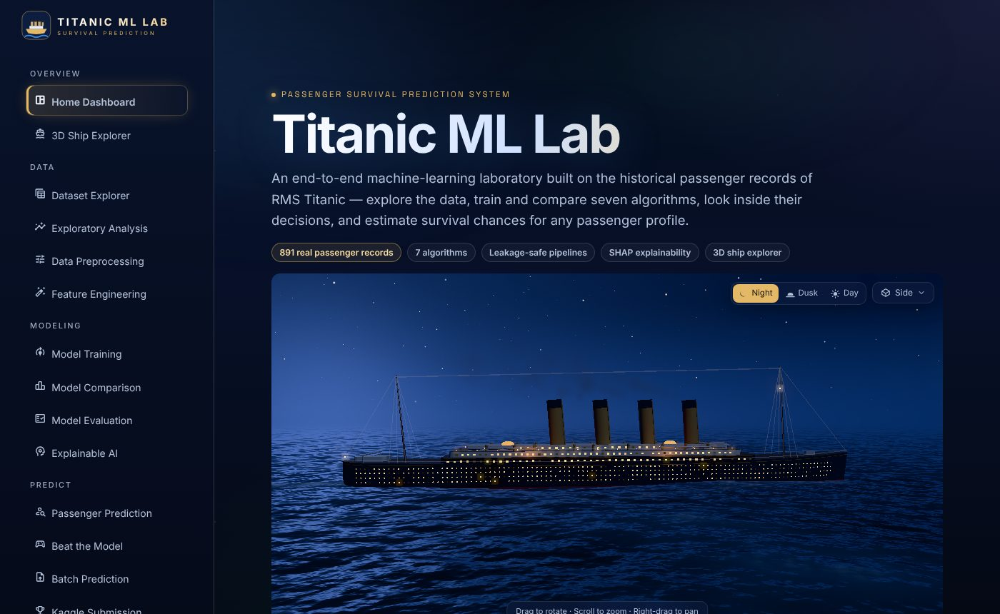
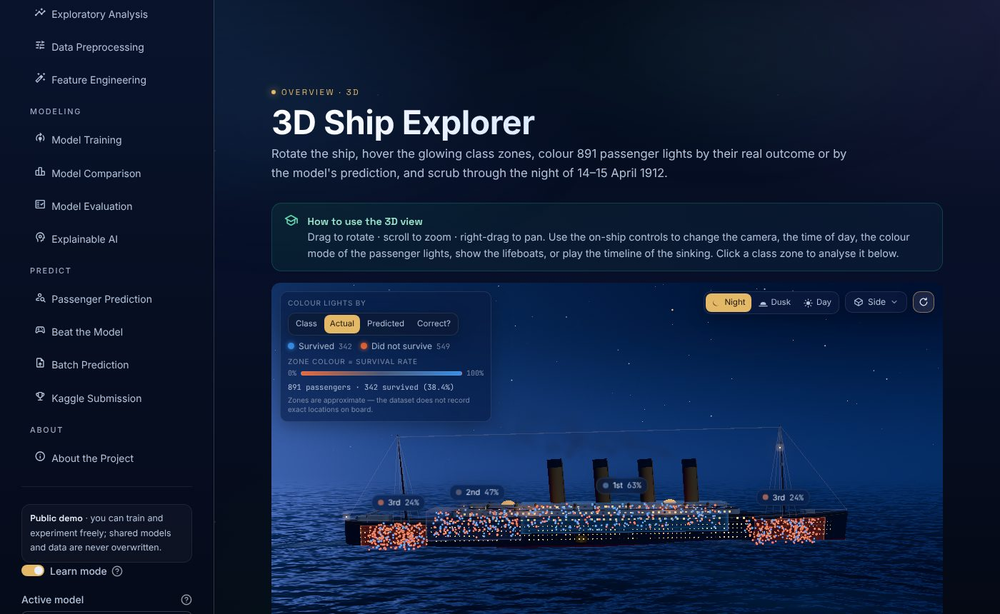
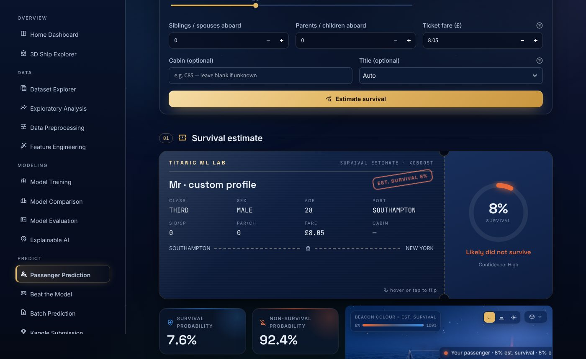
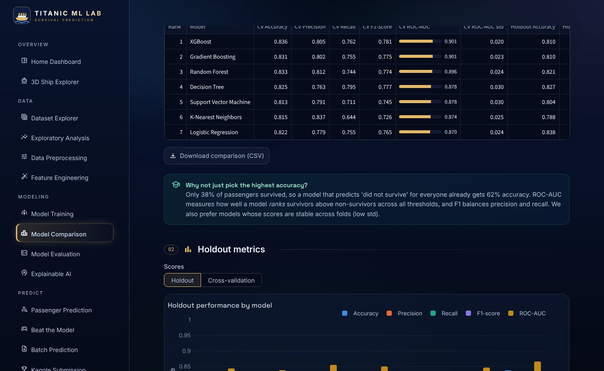

# 🚢 Titanic ML Lab — Passenger Survival Prediction System

An end-to-end, educational machine-learning application built on the historical passenger records of RMS Titanic.
Explore the data, engineer features, train and compare seven algorithms, look inside their decisions with
explainable AI, predict survival for any passenger profile, and walk around an interactive **3D model of the ship** —
all in a polished dark-navy web app that runs locally with `streamlit run app.py`.

> **Predictions are statistical estimates learned from historical data — not statements about any real individual.**

---

## Contents
1. [Introduction](#1-introduction) · 2. [Problem statement](#2-problem-statement) · 3. [Dataset](#3-dataset) ·
4. [Technologies](#4-technologies) · 5. [ML workflow](#5-machine-learning-workflow) · 6. [Feature engineering](#6-feature-engineering) ·
7. [Algorithms](#7-algorithms) · 8. [Evaluation metrics](#8-evaluation-metrics) · 9. [Architecture](#9-project-architecture) ·
10. [Installation](#10-installation) · 11. [Getting the dataset](#11-getting-the-dataset) · 12. [Running the app](#12-running-the-app) ·
13. [Training models](#13-training-models) · 14. [Making predictions](#14-making-predictions) · 15. [Kaggle submissions](#15-kaggle-submissions) ·
16. [Limitations](#16-limitations) · 17. [Future improvements](#17-future-improvements) · [License](#license)

---

## 1. Introduction
**Titanic ML Lab** is more than a notebook: it is a complete ML ecosystem with dataset acquisition and validation, EDA,
leakage-safe preprocessing, feature engineering with ablation experiments, seven tuned classifiers, cross-validation,
holdout evaluation, SHAP explanations, single / batch / Kaggle predictions, model monitoring, automated tests and a
15-page Streamlit application with a custom "Midnight Atlantic" design system.

Highlights of the app:

| | |
|---|---|
| 🛳️ **3D Ship Explorer** | A Three.js Titanic on an animated night ocean. Rotate and zoom, colour 891 passenger lights by real outcome or model prediction, click class zones to analyse them, toggle the lifeboats and scrub through the timeline of 14–15 April 1912. |
| 🎫 **Boarding-pass predictions** | Each estimate appears as a vintage boarding pass with an animated probability ring. Hover over it to flip it and see the SHAP explanation. |
| 🧪 **What-if lab** | Change class, sex, age or family and watch the estimate update live, with age and fare curves. |
| 👥 **Similar real passengers** | The 5 nearest real records from `train.csv`, plus a rotatable 3D "passenger galaxy". |
| 🎮 **Beat the Model** | Guess the fate of 10 real holdout passengers and compete against the model. |
| 🏔️ **3D probability landscape** | A survival-probability surface over age × fare. Compare a smooth Logistic Regression with a staircase Decision Tree. |
| 📚 **Learn mode** | Plain-language explanations of every ML concept, which you can switch on or off in the sidebar. |

### Screenshots
| Home dashboard | 3D Ship Explorer |
|---|---|
|  |  |
| **Passenger prediction (boarding pass)** | **Model comparison** |
|  |  |

## 2. Problem statement
Binary classification: given a passenger's ticket class, sex, age, family aboard, fare, port, cabin, name and ticket,
estimate the probability that they **survived** (`Survived = 1`) or **did not survive** (`Survived = 0`) the sinking.

## 3. Dataset
Kaggle — *Titanic: Machine Learning from Disaster* (<https://www.kaggle.com/competitions/titanic/data>).

| File | Rows | Target | Use |
|---|---|---|---|
| `train.csv` | 891 | ✔ `Survived` | development (712) + holdout (179) |
| `test.csv` | 418 | ✘ (hidden by Kaggle) | Kaggle submission only |

Columns: `PassengerId, Pclass, Name, Sex, Age, SibSp, Parch, Ticket, Fare, Cabin, Embarked` (+ `Survived`).
Missing: Age 177, Cabin 687, Embarked 2 (train); Age 86, Cabin 327, Fare 1 (test).
Both files are checked against the official Kaggle SHA-256 checksums stored in `config.yaml`.
Fares are in pounds sterling (£).

## 4. Technologies
Python 3.11+ · pandas · NumPy · SciPy · scikit-learn · XGBoost (optional) · SHAP (with a built-in fallback) · Joblib ·
Matplotlib · Seaborn · Plotly · Streamlit · Three.js r180 (vendored, works offline) · PyYAML · Pytest.

## 5. Machine-learning workflow
```
train.csv (891, labelled)
 └─ stratified 80/20 split, seed 42
     ├─ development set (712) ─► 5-fold StratifiedKFold CV + RandomizedSearchCV
     │                           every fold refits: feature engineer → imputers → encoders → scaler → model
     └─ holdout set (179) ─────► used once, for the final reported metrics
test.csv (418, unlabelled) ────► Kaggle submission only
```
* **One pipeline:** `TitanicFeatureEngineer → ColumnTransformer(numeric | categorical | binary) → model`. Everything is
  fitted inside `fit`, so cross-validation never leaks validation rows into imputation values, encodings or scalers.
  `tests/test_preprocessing.py` checks this.
* **Missing values:**
  * Age: median per title group, learned in `fit`, plus an `AgeKnown` flag. Plain median imputation is an option.
  * Embarked: most frequent port.
  * Fare: median.
  * Cabin: converted to `CabinKnown` and `Deck`, with "Unknown" kept as its own category.
* **Encoding & scaling:** one-hot encoding with `handle_unknown="ignore"`. StandardScaler, RobustScaler and no scaling
  were compared per model by experiment.
* **Outliers:** IQR and z-score report. Extreme fares and large families are real passengers and are **kept**.
* **Model selection:** highest mean CV ROC-AUC, with CV F1 and then fold stability as tie-breakers. Accuracy is never
  used alone, and the holdout is never used for selection.
* **Final models** are refit on all 891 labelled rows for predictions and the Kaggle file.

## 6. Feature engineering
| Feature | Definition |
|---|---|
| FamilySize | SibSp + Parch + 1 |
| IsAlone | FamilySize == 1 |
| Title / TitleGroup | Extracted from the name → Mr, Mrs, Miss, Master, Other |
| FarePerPerson | Fare ÷ FamilySize |
| AgeGroup | Child, Teen, Young adult, Adult, Senior |
| FamilyCategory | Alone, Small family (2–4), Large family (5+) |
| CabinKnown / Deck | Whether a cabin is recorded, and the deck letter A–G (or Unknown) |
| TicketGroupSize | Passengers sharing the ticket. Learned from training rows only, with no target used; falls back to FamilySize |
| AgeKnown | Missing-age indicator |

The features are tested rather than assumed useful:
* **Base (7) vs engineered (17):** the engineered set improved CV ROC-AUC for all 7 algorithms.
* **Drop-one ablation:** Title is the most valuable engineered feature. The others overlap heavily, so each one alone
  moves CV by less than the fold-to-fold noise. See [`PROJECT_REPORT.md`](PROJECT_REPORT.md).

## 7. Algorithms
| Model | Purpose | Strengths | Limitations |
|---|---|---|---|
| Logistic Regression | Interpretable baseline | Fast, calibrated, coefficients readable | Linear in log-odds |
| Decision Tree | Human-readable rules | Interpretable, non-linear | High variance, overfits |
| Random Forest | Averaged decorrelated trees | Strong, robust | Larger, less interpretable |
| K-Nearest Neighbors | "Passengers like you" | Intuitive | Needs scaling, sensitive to one-hot noise |
| Support Vector Machine | Max-margin boundary | Kernels for non-linearity | Needs scaling and probability calibration |
| Gradient Boosting | Sequential error-correcting trees | Top tabular accuracy | More tuning, can overfit |
| XGBoost *(optional)* | Regularised boosting | Accurate, efficient | Extra dependency, many knobs |

Results from the run included in this repository (5-fold CV on the 712 development passengers; holdout = 179 passengers):

| Model | CV ROC-AUC (5-fold) | Holdout accuracy | Holdout F1 | Holdout ROC-AUC |
|---|---|---|---|---|
| XGBoost ★ | 0.901 ± 0.020 | 0.810 | 0.742 | 0.844 |
| Gradient Boosting | 0.901 ± 0.023 | 0.810 | 0.746 | 0.838 |
| Random Forest | 0.896 ± 0.024 | 0.821 | 0.758 | 0.855 |
| Decision Tree | 0.878 ± 0.030 | 0.827 | 0.783 | 0.850 |
| Support Vector Machine | 0.878 ± 0.030 | 0.804 | 0.741 | 0.825 |
| K-Nearest Neighbors | 0.874 ± 0.025 | 0.788 | 0.732 | 0.847 |
| Logistic Regression | 0.870 ± 0.024 | 0.838 | 0.785 | 0.866 |

★ = selected by CV ROC-AUC. Logistic Regression scored best on the small holdout. With 179 passengers, differences of
2–3 points are within sampling noise, which is exactly why the holdout is not used for selection. Your numbers may
differ slightly after retraining on a different machine or library version.

## 8. Evaluation metrics
* **Accuracy** — the overall share of correct predictions.
* **Precision** — of the passengers predicted to survive, how many actually survived?
* **Recall** — of the passengers who actually survived, how many did the model identify?
* **F1-score** — the balance (harmonic mean) of precision and recall.
* **ROC-AUC** — how well the model ranks survivors above non-survivors across all thresholds (0.5 = random, 1 = perfect).

The app also shows confusion matrices, ROC and precision-recall curves, a calibration curve, an interactive threshold
slider, learning curves and per-fold CV scores. **Validation ≠ Kaggle leaderboard:** the leaderboard uses hidden labels
for `test.csv`.

## 9. Project architecture
```
app.py                     # entry point: theme, grouped navigation, global sidebar (learn mode, active model)
config.yaml                # paths, seeds, CV folds, search sizes, checksums
app_pages/                 # the 15 Streamlit pages (see note below)
  0_Home.py  13_Ship_Explorer_3D.py  1_Dataset_Explorer.py  2_Exploratory_Analysis.py  3_Data_Preprocessing.py
  4_Feature_Engineering.py  5_Model_Training.py  6_Model_Comparison.py  7_Model_Evaluation.py  8_Explainable_AI.py
  9_Passenger_Prediction.py  14_Beat_the_Model.py  10_Batch_Prediction.py  11_Kaggle_Submission.py  12_About.py
src/
  config.py  data_loader.py  data_validation.py  feature_engineering.py  preprocessing.py  eda.py
  models.py  train.py  evaluate.py  explainability.py  prediction.py  batch_prediction.py  submission.py  model_manager.py
  ui/  theme.py (CSS design system) · components.py (cards, boarding pass…) · charts.py (Plotly theme) · state.py (caching) · ship.py
components/ship3d/         # custom bidirectional Streamlit component: Three.js ship, ocean, sky, overlays (offline)
scripts/                   # download_data · validate_data · train_all · make_submission · generate_report
data/raw/ data/processed/  # Kaggle CSVs (committed) and processed exports
models/                    # trained pipelines + metadata + run history (committed; retrained automatically if library versions differ)
outputs/figures/ outputs/reports/  # report figures, experiments.json
notebooks/exploratory_analysis.ipynb
tests/                     # pytest: data, features, preprocessing & leakage, training, predictions, batch, submission, app pages
```
`src/` (except `src/ui`) has no Streamlit dependency, so the same code powers the app, the scripts, the notebook and the tests.

> **Why `app_pages/` and not `pages/`?** Streamlit treats a folder named `pages/` as a legacy auto-navigation folder.
> If you open a deep link such as `/Passenger_Prediction` right after the server starts, it can run that page *without*
> `app.py`, which drops the theme and the grouped navigation. The folder is named `app_pages/` and the navigation is
> defined explicitly with `st.navigation`, so this can't happen.

## 10. Installation
Requires Python 3.11 or newer (tested on 3.13).

macOS / Linux:
```bash
python3 -m venv .venv
```
```bash
source .venv/bin/activate
```
```bash
pip install -r requirements.txt
```
Windows (PowerShell):
```bash
py -m venv .venv
```
```bash
.venv\Scripts\Activate.ps1
```
```bash
pip install -r requirements.txt
```
Optional extras (Kaggle API, notebook execution, screenshot tooling): `pip install -r requirements-dev.txt`.

## 11. Getting the dataset
`data/raw/train.csv` and `data/raw/test.csv` are already included in the repository. To check or re-acquire them:
```bash
python scripts/download_data.py
```
This tries, in order: local files → the **Kaggle API** (if `~/.kaggle/kaggle.json` or `KAGGLE_USERNAME`/`KAGGLE_KEY` is set)
→ a public mirror of the identical files, accepted only if the SHA-256 checksum matches Kaggle's. You can also upload the
CSVs in the app (Dataset Explorer page) or download them manually:
1. Sign in at kaggle.com and open <https://www.kaggle.com/competitions/titanic/data>.
2. Accept the rules and click **Download All**.
3. Copy `train.csv` and `test.csv` into `data/raw/`.

Validate the data with:
```bash
python scripts/validate_data.py
```

## 12. Running the app
```bash
streamlit run app.py
```
Open <http://localhost:8501>. If no models are trained yet, the app offers a one-click **Train all models** button.

## 13. Training models
Full run: experiments plus tuning of all 7 models (about 3–5 minutes on a laptop):
```bash
python scripts/train_all.py
```
Quick run (8 search candidates per model, no experiments):
```bash
python scripts/train_all.py --quick
```
Specific models only:
```bash
python scripts/train_all.py --models random_forest svm
```
In the app, **Model Training** lets you pick an algorithm, tune it automatically or set hyper-parameters by hand,
watch fold-by-fold progress, and save the result. It also includes the *Overfitting playground* and *Feature switchboard*.
Every run is logged to `models/run_history.jsonl` (shown under **Model Comparison → Run history & monitoring**).

Rebuild `PROJECT_REPORT.md` and its figures from the trained models:
```bash
python scripts/generate_report.py
```

## 14. Making predictions
* **Passenger Prediction** page: fill in the form, or load a clearly fictional sample profile or a real record from
  `train.csv`. You get the boarding pass, survival and non-survival probabilities, a SHAP waterfall, plain-language
  factors, the what-if lab, similar real passengers and the 3D beacon. Inputs are validated, and the app warns when a
  value is outside the training range.
* **Batch Prediction** page: download the CSV template, upload your file, and download the predictions. Required
  columns are `Pclass, Sex, Age, SibSp, Parch, Fare, Embarked`; Age, Fare and Embarked may be blank. No `Survived`
  column is needed. A drift check (PSI) compares your file with the training data.

## 15. Kaggle submissions
In the app, open the **Kaggle Submission** page, pick a model, then generate, validate and download. From the CLI:
```bash
python scripts/make_submission.py
```
The output, `outputs/submission.csv`, has exactly `PassengerId,Survived` and 418 rows of 0/1 integers, in the same
order as `test.csv`. The file is validated before it is saved. **The leaderboard score is only available by submitting
at <https://www.kaggle.com/competitions/titanic/submit>**, because Kaggle's test labels are private.

## Deployment
The repository is deployment-ready. The trained models in `models/` are committed, so the app starts instantly, and
on Python ≥ 3.12, `requirements.txt` pins the exact library versions they were trained with. If a server ends up with
different versions, the app notices at start-up and retrains the models once, on its own.

**Public demo mode.** Set `TITANIC_DEMO_MODE=true` (environment variable or Streamlit secret) for any public
deployment. Visitors can still train models and see the results, but those runs are not saved, so nobody can change
the shared models or replace the dataset.

### Option A — Streamlit Community Cloud (free, recommended)
1. Go to <https://share.streamlit.io> and sign in with GitHub.
2. Click **Create app** → **Deploy a public app from GitHub** and choose:
   * Repository: `aarushagrawal267-maker/titanic-survival-prediction`
   * Branch: `main`
   * Main file path: `app.py`
   * App URL: pick a name, e.g. `titanic-ml-lab`
3. Open **Advanced settings**:
   * Python version: **3.13**
   * Secrets: `TITANIC_DEMO_MODE = "true"`
4. Click **Deploy**. The first build installs the dependencies (a few minutes). The app then lives at
   `https://<your-name>.streamlit.app`.

Memory: the app uses about 0.9 GB under load, which fits Community Cloud's limits.

### Option B — Docker (Render, Railway, Fly.io, a VPS…)
```bash
docker build -t titanic-ml-lab .
```
```bash
docker run -p 8501:8501 titanic-ml-lab
```
The image uses Python 3.13, runs as a non-root user, has a health check at `/_stcore/health`, enables demo mode by
default and respects the `PORT` variable that most hosts set. On Render, create a **Web Service** from the repository
with the *Docker* runtime and pick an instance with **at least 1 GB RAM** (the 512 MB free tier is too small).

## Tests
```bash
pytest
```
[](https://github.com/aarushagrawal267-maker/titanic-survival-prediction/actions/workflows/tests.yml)
The same suite runs automatically on GitHub Actions (`.github/workflows/tests.yml`) for every push and pull request.

85 tests cover:
* data loading and validation;
* feature engineering;
* preprocessing, including **leakage checks** (fold-only statistics, labels never used, disjoint holdout);
* training and model selection;
* prediction probabilities in [0, 1] that sum to 1, with binary labels;
* SHAP additivity;
* batch scoring and drift;
* submission format;
* a Streamlit `AppTest` smoke test of all 15 pages, plus the prediction, batch, Kaggle and game flows.

## 16. Limitations
* **Small data:** 891 labelled passengers, so holdout metrics carry about ±3 percentage points of uncertainty.
* **Optimistic CV:** CV scores of tuned models are slightly optimistic. Nested CV would fix this.
* **Associations, not causes:** sex, class and age are historical correlates. The models must not be used to judge individuals.
* **Missing information:** cabin is missing for 77% of passengers and age for 20%. Crew are absent.
* **Approximate ship zones:** the dataset has no positions on board, so the 3D ship's class zones are approximate and
  the model itself is a stylised procedural model.
* **SHAP caveat:** SHAP with correlated features (Sex ↔ Title, FamilySize ↔ IsAlone) splits credit between them in
  ways that need careful reading.

## 17. Future improvements
Stacking and voting ensembles · nested CV · Optuna/Bayesian tuning · fairness analysis across sex and class ·
conformal prediction intervals · optional real glTF ship model.
(A Dockerfile and a GitHub Actions test workflow are already included.)

## License
The code in this repository is released under the [MIT License](LICENSE).
Third-party parts keep their own licences: Three.js (MIT, see `components/ship3d/frontend/vendor/three/LICENSE`).
The Titanic CSV files come from the Kaggle *Titanic: Machine Learning from Disaster* competition and are subject to
Kaggle's competition rules.

---
*In memory of the more than 1,500 passengers and crew who lost their lives on 15 April 1912.*
